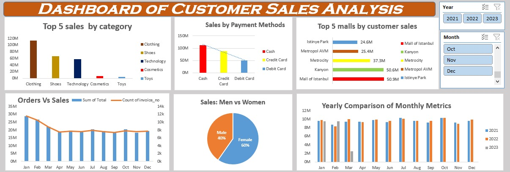

# 📊 Sales Performance & Customer Insights

## 📂 Category Performance
* **Clothing:** Dominates total sales revenue.
* **Shoes & Technology:** Follow closely behind as top-performing categories.
* **Cosmetics & Toys:** Represent smaller revenue shares.

---

## 👥 Customer Demographics
* **Female Shoppers:** Drive the majority of sales (**60%**).
* **Male Shoppers:** Account for the remaining **40%** of sales.

---

## 💳 Payment Preferences
* **Cash:** Most preferred payment method (~112M)
* **Credit Cards:** ~88M
* **Debit Cards:** ~50M

---

## 🛍️ Top Performing Malls
* **Mall of Istanbul:** 50.9M
* **Kanyon:** 50.6M
*(These locations lead customer sales among all available locations.)*

---

## 📈 Seasonality & Trends
* **Peak Period:** Sales revenue and order volume peak highest at the beginning of the year (**January & February**).
* **Steady Period:** Remains steady and consistent across all subsequent months.

---

## 📸 Dashboard

 

## 💡 Key Business Insights

* **Category Performance:** **Clothing** dominates total sales revenue, followed by **Shoes** and **Technology**. **Cosmetics** and **Toys** represent smaller revenue shares.
* **Customer Demographics:** **Female shoppers** drive the majority of sales (**60%**), compared to **Male shoppers** (**40%**).
* **Payment Preferences:** **Cash** is the most preferred payment method (~112M), followed by **Credit Cards** (~88M) and **Debit Cards** (~50M).
* **Top Performing Malls:** **Mall of Istanbul** (50.9M) and **Kanyon** (50.6M) lead customer sales among all locations.
* **Seasonality & Trends:** Sales revenue and order volume peak highest at the beginning of the year (**January & February**), remaining steady across the subsequent months.
